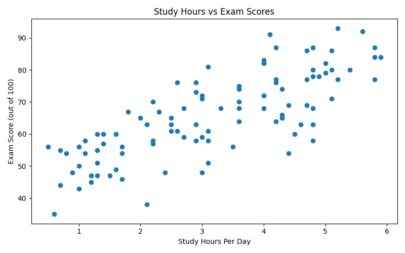
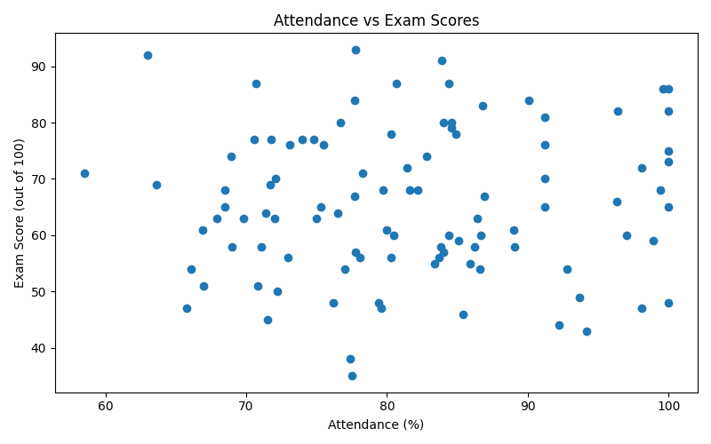
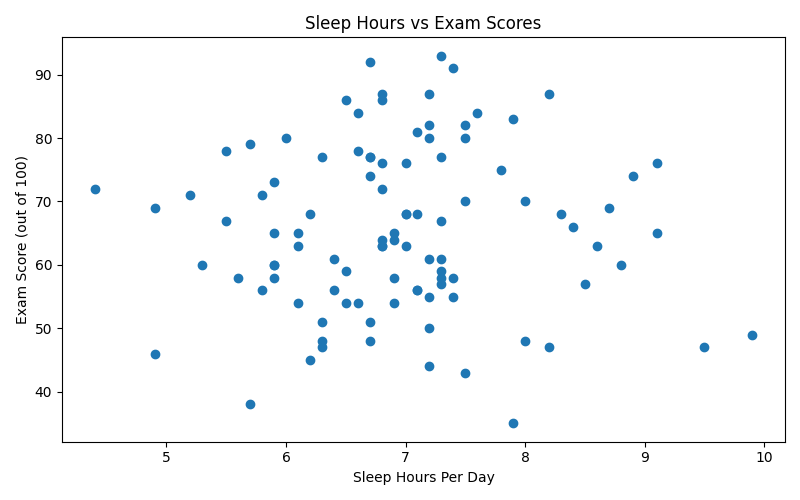

# Student Performance Analysis

## Exploratory Data Analysis with a Finding

### 1. Project Overview

This project explores the relationship between students' daily study hours, attendance, sleep hours, and exam scores. Python was used to analyse the dataset, calculate correlations, and create visualisations.

The objective is to identify which factor has the strongest linear relationship with exam scores and test whether the initial expectations are supported by the data.

### 2. Dataset Description

- **Dataset name:** Student Performance Analysis Dataset
- **Number of student records:** 100
- **Data type:** Synthetic practice data
- **Tools used:** Python, Pandas, Matplotlib, Plotly, Streamlit
- **Analysis method:** Exploratory Data Analysis (EDA), correlation analysis, and data visualisation

The dataset contains the following variables:

| Variable | Description |
|---|---|
| Student ID | Unique identifier for each student |
| Study Hours Per Day | Number of hours spent studying daily |
| Attendance Percent | Student attendance percentage |
| Sleep Hours Per Day | Number of hours slept daily |
| Exam Score Out of 100 | Student's exam score |

**Note:** This is synthetic practice data and does not represent real students.

### 3. Research Questions

1. Is daily study time positively associated with exam scores?
2. Does higher attendance correspond to higher exam scores in this dataset?
3. Is sleep duration linearly associated with exam scores?
4. Which variable has the strongest linear relationship with exam scores?

### 4. Hypotheses

**Hypothesis 1: Study Hours**

Students who spend more hours studying per day are expected to have higher exam scores.

**Hypothesis 2: Attendance**

Students with higher attendance percentages are expected to have higher exam scores.

**Hypothesis 3: Sleep Hours**

Sleep duration may show a linear relationship with exam scores.

These are initial expectations to be tested against the dataset, not established facts.

### 5. Data Analysis Method

The dataset was loaded and analysed using Python and Pandas. Correlation coefficients were calculated to measure the direction and strength of the linear relationships between study hours, attendance, sleep hours, and exam scores.

Correlation coefficients range from -1 to +1:

- A value close to +1 indicates a strong positive linear relationship.
- A value close to -1 indicates a strong negative linear relationship.
- A value close to 0 indicates little or no linear relationship.

Scatter plots were created to visually inspect the relationships between the variables and exam scores.

### 6. Results and Evidence

The analysis produced the following correlation values:

| Variable | Correlation with Exam Score | Interpretation |
|---|---:|---|
| Study Hours Per Day | 0.772 | Strong positive linear relationship |
| Attendance Percent | 0.051 | Almost no linear relationship |
| Sleep Hours Per Day | 0.002 | Almost no linear relationship |

#### Finding 1: Study Hours Had the Strongest Relationship

The correlation between daily study hours and exam scores was **0.772**. This indicates a strong positive linear relationship in the synthetic dataset.

The study-hours scatter plot provides visual evidence of this pattern. Among the three variables examined, study hours had the strongest observed linear association with exam scores.

This supports Hypothesis 1 within this dataset. However, correlation does not prove that increasing study hours causes higher exam scores.

#### Finding 2: The Attendance Expectation Was Not Supported

The initial expectation was that students with higher attendance would also have higher exam scores.

However, the observed correlation was only **0.051**, which is very close to zero. The analysis did not find a meaningful linear relationship between attendance and exam scores in this dataset.

This result does not support the initial expectation. It does not prove that attendance is unimportant in real educational settings.

#### Finding 3: Sleep Hours Showed Almost No Linear Relationship

The correlation between sleep hours and exam scores was **0.002**, which is approximately zero.

The analysis found almost no linear relationship between sleep duration and exam scores in this synthetic dataset. This does not establish that sleep has no effect on academic performance.

## 7. Visualizations

### Graph 1: Study Hours vs Exam Scores

Study hours and exam scores have a strong positive correlation of 0.772.

### Graph 2: Attendance vs Exam Scores

Attendance and exam scores have a very weak correlation of 0.051.

### Graph 3: Sleep Hours vs Exam Scores

Sleep hours and exam scores have almost no linear correlation (0.002).

### 8. Main Finding for a Stakeholder

The strongest finding is that **study hours had a much stronger positive linear relationship with exam scores than attendance or sleep hours in this dataset**.

The study-hours correlation was 0.772, compared with 0.051 for attendance and 0.002 for sleep hours. The initial expectation that higher attendance would correspond to higher scores was not supported by the observed correlation.

For a stakeholder, this means that study hours stood out as the strongest linear correlate among the three factors examined in this practice dataset. These results should not be used to make real student assessment or education policy decisions.

### 9. Limitations

1. The dataset is synthetic and may not reflect real student behaviour or academic performance.
2. Correlation measures linear relationships and may not capture nonlinear patterns.
3. Correlation does not prove causation.
4. Other factors, such as prior academic performance, teaching quality, study methods, and exam difficulty, were not evaluated.
5. The analysis is based on 100 records and should not be generalised to all students.

